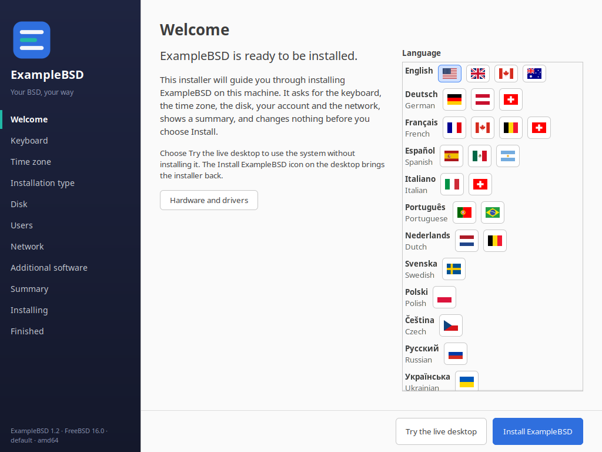
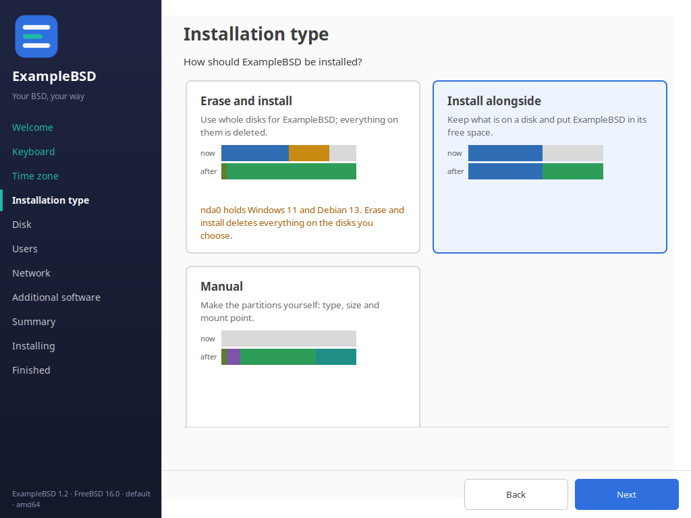
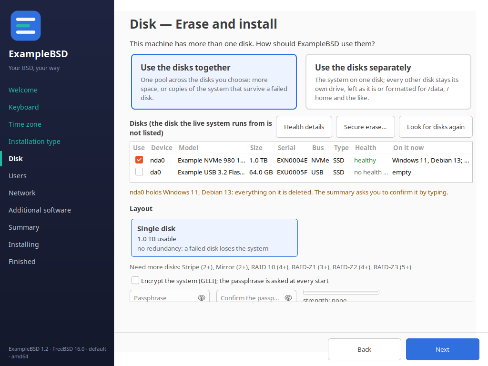
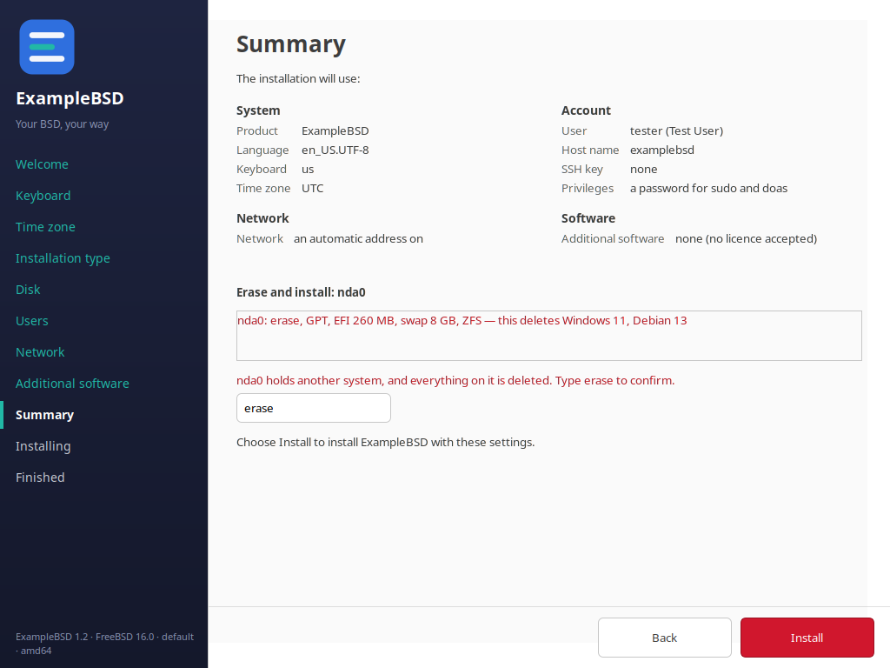
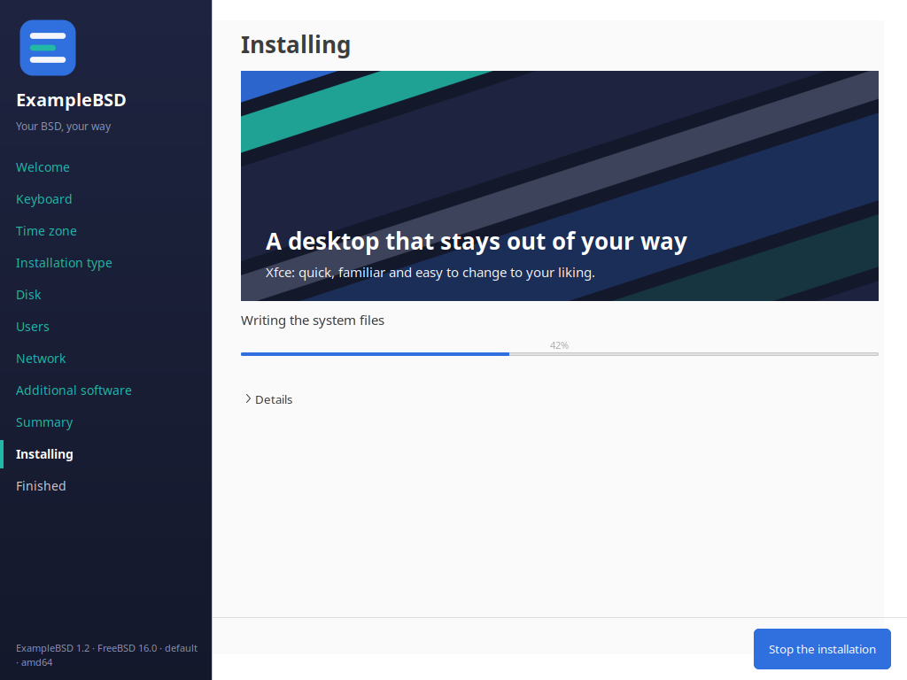
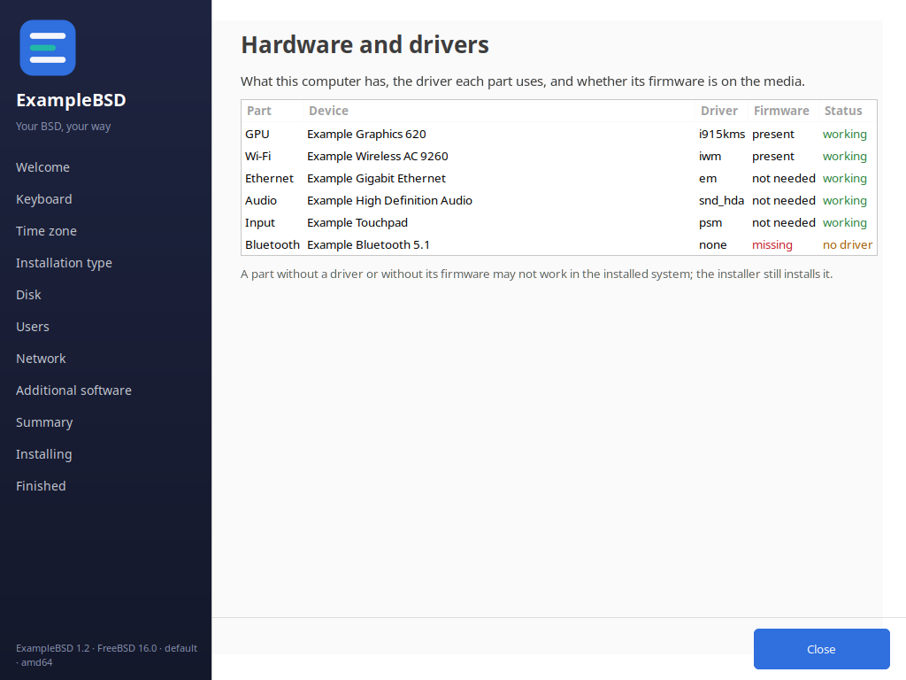
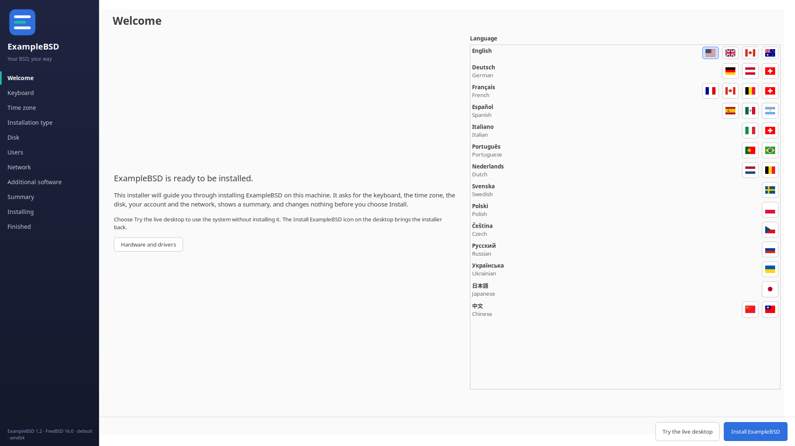
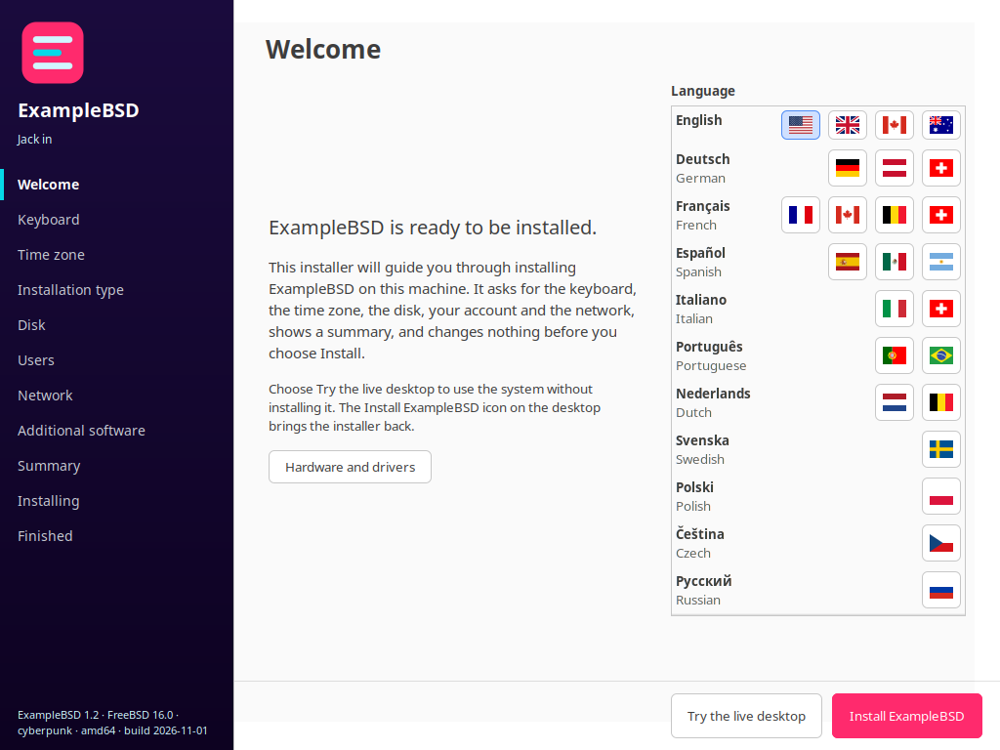
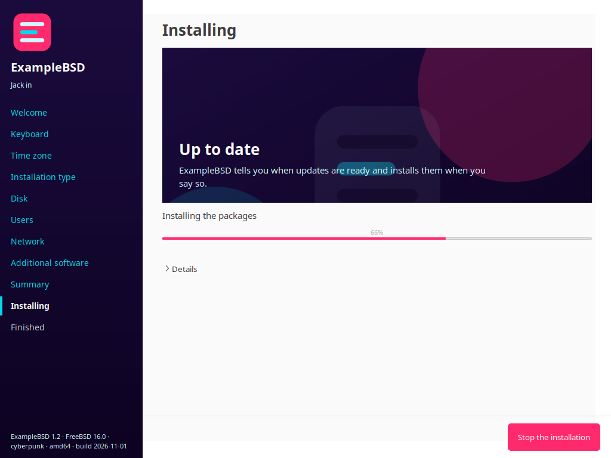

# Copyright (c) 2026 The wtfbsd contributors. BSD-2-Clause (see LICENSE).

# installer-template

A generic, overlay-configurable BSD installer:

- a section dispatch backend in POSIX sh,
- a `bsddialog(1)` text front end,
- a full-screen GTK 3 graphical front end (Python 3 and PyGObject only),
  driving the same backend, gating and answers as the text one,
- a pure answer-gating module in Python 3 (standard library only),
- per-OS adapters for FreeBSD, NetBSD, OpenBSD and DragonFly, which install
  through the install command of the template,
- a small root helper, `installer-apply`, the only part that runs as root:
  both front ends run as the user of the session,
- `install-into-stage.sh`, which puts all of it into the tree of a live
  image, with a launcher, a menu entry and the start of the live session.

The product is a variable.  The shipped configuration calls the product
ExampleBSD; a site changes `installer.conf` and adds an adapter, and the
installer core stays as it is.

## What it looks like

The graphical front end on FreeBSD 16.0, drawn from the test fixtures
(sample data: made-up disks, documentation addresses, the placeholder
product ExampleBSD of the artwork template).  The line in the lower left of
every picture says what it shows: product, version, the BSD, the variant of
the artwork and the architecture (`/usr/local/share/<slug>/identity` of the
image).  `gui/README.md` shows every page.

| | |
| --- | --- |
|  |  |
|  |  |
|  |  |

At 1920x1080: 

The cyberpunk variant of the artwork (FreeBSD 16.0, a test build):

| | |
| --- | --- |
|  |  |

`tools/render-screenshots.sh` renders the pictures again, headless (GTK on
its Broadway backend, no X server): run it after a change to a page and
commit `docs/screenshots/`.

## Layout

| Path | What it is |
| --- | --- |
| `bin/installer-backend` | the section dispatcher |
| `bin/installer-config` | reads and validates `installer.conf` |
| `bin/installer-tui` | the text front end |
| `bin/installer-gui` | the graphical front end: runs `lib/gui.py` with `python3 -I` |
| `lib/gui.py` | the GTK 3 pages of the graphical front end |
| `bin/installer-apply` | the root helper: the only part that runs as root |
| `lib/apply.py` | the work of the root helper (Python standard library only, no GTK) |
| `lib/rootguard.sh` | drops every override of the environment for root |
| `install-into-stage.sh` | installs the installer into the tree of a live image |
| `stage/*.in` | the launcher, the session helper and the desktop entries it installs |
| `lib/backend.sh` | shared shell helpers (JSON, key/value files, the adapter call) |
| `lib/config.sh` | the configuration parser and its anchored patterns |
| `lib/accounts.sh` | the rules of the first account of the installed system |
| `lib/adapter.sh` | the part of the adapters that is the same on every system |
| `lib/gating.py` | the pure answer gating |
| `lib/passhash.py` | turns the password into a crypt(3) hash |
| `lib/wizard.py` | the logic of the graphical front end, without GTK |
| `sections.d/*.sh` | one script per installer section |
| `adapters/*.sh` | one script per operating system |
| `installer.conf` | the product configuration |
| `tests/` | the test suite and its fixtures |
| `gui/README.md` | the pages and the rules of the graphical front end |
| `Jenkinsfile` | the generic CI pipeline |
| `AGENTS.md` | the rules for agents that work in this repository |

## The backend contract

`installer-backend <section> <verb> [arguments...]`

The dispatcher refuses an unknown section or an unknown verb with exit code
2 and says why.  A section name matches `^[a-z][a-z0-9-]*$`.  The dispatcher
runs `sections.d/<section>.sh <verb> [arguments...]` and passes its exit code
on.

| Verb | What it does |
| --- | --- |
| `probe` | read only; prints one JSON object on standard output |
| `validate` | checks the answers; changes nothing |
| `apply` | does the work |
| `verify` | checks that the work was done |

| Exit code | Meaning |
| --- | --- |
| 0 | ok |
| 2 | bad input |
| 3 | environment error |
| 4 | fatal |

| Section | `probe` prints | `apply` and `verify` |
| --- | --- | --- |
| `welcome` | the product name, the slug and the system | nothing |
| `keyboard` | the keyboard layouts of the adapter and the default | nothing |
| `timezone` | the time zones of the adapter and the default | nothing |
| `disk` | the disks the adapter offers | the adapter prepares the disk |
| `users` | the accounts and the crypt scheme of the system (`hash_scheme`) | nothing; the install step makes the account |
| `network` | the network adapters the adapter offers | nothing |
| `summary` | the fields the summary page shows | nothing |
| `install` | the steps of the installation | the adapter installs the system |

The section of the accounts checks the answers and it makes no account: the
install step makes the account and it reads the crypt hash in the file that
the answer `USER_HASHFILE` names.  The section of the accounts checks that the
file is there and holds a crypt hash (`$6$`, `$2a$` or `$2b$`), checks the
optional full name, host name and SSH key file, and refuses a name that is an
account of the system that is installed.

## The adapter contract

The operating system specific work goes through `adapters/<os>.sh`.  The
adapter is named by `OS` in `installer.conf`.  The part that is the same on
every system is in `lib/adapter.sh`; an adapter only says how its system
lists its disks, its network adapters and its keyboard layouts and which
crypt scheme it accepts.

| Operation | What it must do |
| --- | --- |
| `disks` | print a JSON array of the disks that may be written to |
| `network` | print a JSON array of the network adapters |
| `apply-disk <disk>` | prepare the disk that was chosen (the install command does it) |
| `verify-disk <disk>` | check that the disk may be written to |
| `apply-install` | run the install command of the template and pass its progress on |
| `verify-install` | check that the install command reported a finished installation |
| `target-root` | print the path of the root of the system that is installed |
| `keymaps` | print `name<TAB>description` for every keyboard layout |
| `timezones` | print `name<TAB>description` for every time zone |
| `hash-scheme` | print the crypt scheme the system accepts |

| System | Disks | Network | Layouts | Crypt scheme |
| --- | --- | --- | --- | --- |
| FreeBSD | `sysctl kern.disks`, `diskinfo`/`geom` | `ifconfig -l` | `/usr/share/vt/keymaps` | `sha512` (`$6$`) |
| NetBSD | `sysctl hw.disknames`, `disklabel`, the kernel messages | `ifconfig -l` | the wscons encodings | `bcrypt-2a` (`$2a$`; NetBSD refuses `$2b$`) |
| OpenBSD | `sysctl hw.disknames`, `disklabel`, the kernel messages | the `<name>: flags=` lines of `ifconfig` | the wscons encodings | `bcrypt` (`$2b$`) |
| DragonFly | `sysctl kern.disks`, the kernel messages | `ifconfig -l` | `/usr/share/syscons/keymaps` | `sha512` (`$6$`) |
| illumos | `diskinfo -Hp`, `iostat -En`, `zpool status`/`import` | `dladm show-phys`; Wi-Fi `dladm scan-wifi` | `/usr/share/lib/keytables/type_6/kbd_layouts` (never `kbd -s`) | `CRYPT_DEFAULT` of `policy.conf` (`6`: `sha512`) |

The illumos adapter's disks, hardware, keymaps and hash scheme, and where
its zone table lives, are tested against outputs captured on OpenIndiana
2026.10 (`tests/fixtures/captures/illumos`, `hw-captures/illumos`,
`tests/fixtures/illumos`): its disks are named `cXtYdZ` (`c2t0d0`), which
every check of a disk name accepts; its hardware comes from `prtconf -D`
and `scanpci`; its zone table is under `/usr/share/lib/zoneinfo`
(`tab/zone_sun.tab`).  It leaves out the disk of the live medium
(`/.cdrom`) and the disks of the pool the root is in (`/etc/mnttab`,
`zpool status`), and when it cannot tell them (`zpool status` fails or
names no disk of that pool, a live root without its medium, a root on
anything else) it offers no disk at all (exit 3, "cannot tell which disks
hold the running system").  Not capture-tested yet, written after the
documented formats: `/etc/mnttab`, `dladm scan-wifi` and the columns of
`tab/zone_sun.tab`.

The time zones of every system are the zone table of zoneinfo
(`zone1970.tab`, else `zone.tab`), with UTC first.  When an adapter has no
list, the section offers its own short list.

Every adapter leaves out the disk of the running system and the disk of the
installation media (the file system mounted on `/mnt`, or on
`INSTALLER_MEDIA_MOUNT`).  Optical drives, memory disks, wedges (NetBSD
`dk`), RAM disks (OpenBSD `rd`) and vnode disks are never offered.  A root
named by a NetBSD wedge, an OpenBSD DUID, a DragonFly `/dev/serno` path or a
HAMMER2 label is followed to its disk.  An array the system assembled by
itself from members it found on the disks (NetBSD RAIDframe `raidN`,
OpenBSD softraid `sdN`, the hook `os_assembled_volumes`) is not offered
either: its members are, shown as members of it.

### What is on the disks now

The verb `disks-detail` reports what each disk holds, for the disk page:
the partition table, every partition with what it is and its file system,
the systems found, the free space, the array a disk is a member of.  An
adapter may bring its own hook `os_disks_detail`; without one,
`lib/diskprobe.py` reads it, only reading, with the tools of the system by
their absolute paths:

| System | Tools |
| --- | --- |
| FreeBSD | `sysctl kern.disks`, `diskinfo -v`, `gpart list`, `fstyp`, `zpool import`, `zdb -l`, `geli dump` |
| NetBSD | `sysctl hw.disknames`, `gpt show -a`, `dkctl listwedges`, `fdisk`, `fstyp`, `raidctl -s` |
| OpenBSD | `sysctl hw.disknames`, `fdisk`, `disklabel -h`, `bioctl` |
| DragonFly | `sysctl kern.disks`, `gpt show`, `fstyp` |

and, on every system, the first MiB and the last sector of a disk or a
partition (opened read only, for LUKS, BitLocker, GELI, a ZFS label and
whether a disk without a table holds anything) and the file names of an EFI
system partition, read from its FAT directories in userland
(`lib/fatdir.py`; the partition is never mounted), to tell which systems
boot from it.  It
was written against the outputs of the real tools on ten disk layouts
(`tests/fixtures/captures`, see its README): a disk of random data is never
called empty, an encrypted partition is named as encrypted, a NetBSD wedge
is matched to its partition by its start (the `dk` numbers change from boot
to boot), the OpenBSD disklabel type of an NTFS partition (MSDOS) is not
believed.  A rehearsal replays captured outputs with `DISKS_CAPTURE`
(directories, `:` between them) and `DISKS_SNIFFS` (what the signature read
finds), or reads a finished report from `DISKS_DETAIL`.

### The hardware

The verb `hardware` reports the graphics, Ethernet, Wi-Fi, audio, Bluetooth
and input devices, the driver each is attached to, whether the firmware it
needs is on the media and whether it works, for the Hardware and drivers
window (`installer-apply --list hardware`).  Without a hook
`os_hardware`, `lib/hwprobe.py` reads it, only reading, by absolute paths:
`pciconf -lv`, `devinfo -v`, `usbconfig list` and the firmware directories
on FreeBSD and DragonFly; `pcictl pci0 list -N`, `drvctl -lt`, `usbdevs -v`
and `/libdata/firmware` on NetBSD; `pcidump -v` (the kernel messages when
the kernel refuses it, as the installer's does), `usbdevs -v` and
`/etc/firmware` on OpenBSD.  A source the system does not have is listed as
not available, never an error.  A rehearsal replays captured outputs with
`HARDWARE_CAPTURE` or reads a report from `HARDWARE`.

### The install command

The installation itself is done by the install command the template ships,
`<PRODUCT_SLUG>-install` on `PATH` (or the path in
`INSTALLER_INSTALL_COMMAND`).  The adapter calls it with the answers:

```
<slug>-install -p PLANFILE | -d DISK   -u USER -H HASHFILE [-k PUBKEYFILE]
               [-n HOSTNAME] [-z TIMEZONE] [-Z utc|local] [-K KEYMAP] [-L LOCALE]
               [-c FULLNAME] [-P] [-A] [-r locked|ROOTHASHFILE] [-E PASSPHRASEFILE]
               [-N IF:dhcp|IF:ADDR/MASK:GW ...] [-6 IF:slaac|IF:ADDR6/PREFIX:GW6 ...]
               [-D RESOLVER ...] [-W WIFIFILE] [-U] [-l ACCEPTFILE] -y --progress
```

| Option | Answer | Notes |
| --- | --- | --- |
| `-p` | `PLAN_FILE` | the disk plan ("The disk plan" below), a 0600 JSON file the root helper wrote after checking it again; both front ends send one. The command acts on the disks of the plan only |
| `-d` | `DISK` | a bare disk name (`ada0`, `wd0`, `sd0`, `da0`), never a path; the older form, without a plan |
| `-E` | `PASSPHRASE_FILE` | the passphrase of an encrypted system, one line of 8 to 1024 bytes in a 0600 file; only with a plan that encrypts (the helper drops it otherwise) |
| `-l` | `ACCEPT_FILE` | the record of the accepted licences (JSON: the ids and the sha256 of each licence text as shown) |
| `-r` | `ROOT_MODE`, `ROOT_HASHFILE` | `locked`, or a 0600 file with root's crypt hash, checked by the helper itself |
| `-W` | `WIFI_FILE` | a 0600 JSON file `{if, ssid, security, psk}`; never with an offline system |
| `-Z`, `-L`, `-A`, `-U` | `CLOCK`, `LOCALE`, `AUTOLOGIN`, `UPDATE_AFTER` | the hardware clock, the locale, automatic login, the updates after the installation |
| `-6`, `-D` | `NET_IPV6_LIST`, `DNS_SERVERS` | per adapter; a resolver's zone (`%em0`) is only an adapter name |
| `-u` | `USER_NAME` | |
| `-k` | `SSH_KEYFILE` | left out when there is no key |
| `-H` | `USER_HASHFILE` | a file of mode 0600, in a directory of mode 0700, holding the crypt hash |
| `-n`, `-z` | `HOSTNAME`, `TIMEZONE` | left out when empty |
| `-K` | `KEYMAP` | the console keymap name of the system; the install command maps it to the X layout of the installed system |
| `-c` | `USER_FULLNAME` | at most 64 characters, no colon, no line break, no control character |
| `-P` | `PRIVILEGE_PASSWORDLESS=yes` | doas and sudo without a password |
| `-N` | `NETWORK_MODE`, `NET_IF`, `IPV4_*` | `IF:dhcp` for an automatic address, `IF:ADDR/MASK:GW` for a manual one (an empty GW means no default route); none for an offline system or DHCP without an adapter chosen (the install command then uses DHCP on every wired adapter) |

Every value is checked before it is put on the command line: the adapter
name has to match `^[a-z][a-z0-9]{0,14}$` and the address, the netmask and
the gateway have to be IPv4 addresses.  A value that is not well formed
stops the installation with an `ERROR` line and the command never runs.

- The front end hashes the password in its own process; the password is
  never on a command line and never in a file.
- The command prints `PROGRESS <0-100> <message>` lines, and `ERROR
  <message>` before a non-zero exit.  The adapter passes them on unchanged;
  when the command fails without an `ERROR` line the adapter adds one.  Its
  exit code is the exit code of the installation.
- An account without a password is refused before the command runs.
- Optional: `<slug>-install --capabilities` prints what the command can do
  with disks, one JSON object in the shape of the adapter hook `os_layouts`
  (`layouts`, `filesystems`, `modes`, `data_pools`, `boot` — a list of
  `uefi` and `bios` —, `encryption`, `home_encryption`, `usages` — a list
  of `together` and `separate` —, `not_offered`).  The installed
  command is looked for in the directories of the system's programs
  (`/usr/local/sbin`, `/usr/local/bin`, `/usr/pkg/sbin`, `/usr/pkg/bin`,
  `/opt/local/sbin`, `/opt/local/bin`, `/usr/sbin`, `/usr/bin`, `/sbin`,
  `/bin`, the slug matching `^[a-z][a-z0-9-]{1,31}$`), never on the
  caller's `PATH`.  Right before it runs it must be a regular file, not a
  symbolic link, executable, owned by root (or, for a caller that is not
  root, by the caller) and writable by its owner only, in a directory that
  is the same.  It is run without a shell, in a
  minimal environment, for 10 seconds at most (its process group is
  killed after that) and 64 KiB of answer at most.  When it answers with an object that has at least one layout, the verb
  `layouts` reports it instead of the adapter's `os_layouts`; other keys
  are left out.  A command without the option, an error or an answer that
  is not usable falls back to `os_layouts` (or the built-in table) without
  a word.  The Disk page offers only the boot modes listed (a single one is
  shown as a text), the filesystems and the layouts listed, and an
  `encryption` of `""` means the system cannot be encrypted: no box, no
  passphrase, a line that says so, and a plan with `encryption.enabled`
  is refused — unless `home_encryption` names how the home directories
  and the data are encrypted (illumos: `ZFS native`): then the box says
  that, a line says the system itself is not encrypted, and
  `encryption.enabled` of the plan means the home directories and the
  data.  `usages` lists how two disks or more may be used; without it
  both are offered; with one, the question is not asked and a plan with
  the other is refused.

### The disk plan

The disk page (both front ends) writes a plan, `plan.json`, that
`lib/diskplan.py` checks; the root helper checks it again, against its own
reading of the disks, before the install command gets it with `-p`:

```json
{"version": 1, "mode": "erase", "boot": "uefi", "disks": ["ada0"],
 "layout": "single", "filesystem": "zfs",
 "encryption": {"enabled": false, "swap": false}, "swap_mb": 4096,
 "sector_4k": true, "trim": true, "wipe": {"ada0": "quick"},
 "confirm_foreign": ["ada0"], "usage": "together",
 "alongside": {"disk": "ada0", "region": {"start_mb": 1, "size_mb": 102400}},
 "partitions": [{"disk": "ada0", "type": "root", "size_mb": 0, "mount": "/"}],
 "data": [{"name": "home", "disks": ["ada1"], "layout": "single",
           "filesystem": "zfs", "mount": "/home"}]}
```

- `mode`: `erase` (whole disks: `disks`, `layout`), `alongside` (the free
  region of one disk: `alongside`) or `manual` (`partitions`); `disks` is
  empty for the last two, `alongside` and `partitions` exist only in their
  mode.
- **The install command acts only on the disks the plan uses**: `disks`,
  `partitions[].disk`, `alongside.disk` and `data[].disks`.  Every other disk
  name in the plan has to be one of those: a `wipe` only of a disk the plan
  erases, a `confirm_foreign` only of an offered disk the plan erases.  Every
  disk has to be one the adapter offers (never the running system or the
  installation media), and no disk twice.
- A disk that holds another system is erased only with its name in
  `confirm_foreign` (the word typed on the summary).
- The smallest disk (Erase) or region (alongside) is the larger of
  `MIN_DISK_GB` and the installed image plus 2 GB plus the swap of the plan.
  The root partition of a Manual plan (size 0 is the rest of its disk) has
  the same minimum without the swap: in a Manual plan the swap is a
  partition of its own.
- A layout that is an encryption (OpenBSD's `crypto` and `raid1c`) needs
  `encryption.enabled`; the Disk page ticks and locks the box when such a
  layout is chosen.
- `layout` and `filesystem` are those the system offers (the adapter verb
  `layouts`); `data` pools only where the system offers them; mount points
  are absolute, without `..`, unique.
- The file is parsed strictly: no duplicate key, no float, depth at most 8,
  lists of at most 256, texts of at most 256 characters, 64 KiB at most.

Set `INSTALLER_ADAPTER_FIXTURE` to a KEY=value file to read the hardware from
that file instead of from the machine.  The keys are `DISKS`, `INTERFACES`,
`INSTALL_EXIT`, `INSTALL_FAIL_ONCE` and `TARGET_ROOT`.  `DISKS` and
`INTERFACES` hold a comma separated list of items; an item is the name of the
disk or of the adapter and it may carry a description and a size in bytes after
a bar:

```
DISKS=ada0|Samsung SSD 860|500107862016,ada1|Samsung SSD 870
INTERFACES=em0|Intel I219-LM
INSTALL_EXIT=3
```

`INSTALL_EXIT` is the exit code the rehearsed installation returns; it is 0
when the key is not there.  `INSTALL_FAIL_ONCE=yes` makes the first attempt of
a rehearsal fail and the attempt after it succeed, so that a retry can be
rehearsed.  `TARGET_ROOT` is the path of the root of the system that is
installed; the accounts of that system are read from
`<TARGET_ROOT>/etc/master.passwd`.

A site that rehearses the installer needs no variable in the environment at
all: it puts the same file next to the configuration file of the installer and
calls it `rehearsal.conf`.  The environment variable wins when it is set.

`KEYMAPS` and `ZONES` (comma separated names) give a rehearsal lists of its
own; without them a rehearsal offers the short lists of the sections.  A
rehearsed installation prints the same `PROGRESS` lines a real one does.

The FreeBSD adapter reads the disks from the machine like this:

- the names come from `sysctl -n kern.disks`,
- the size comes from `diskinfo -v <name>` and, when that is not there, from
  `geom disk list <name>`,
- the description comes from the `descr` line of `geom disk list <name>`.  The
  name of the field is matched without regard to its case,
- the disk that holds the running system and the disk that holds the
  installation media are left out.  The device of the root file system names
  its disk in several ways and every one of them is understood:
  `/dev/ada0p3` is a partition of a GPT disk, `/dev/da0s1a` is a slice of an
  MBR disk with a BSD label, `/dev/ufs/root`, `/dev/gpt/root` and
  `/dev/label/root` are labels whose device is in the list that
  `glabel status -s` prints (the columns are the name, the state and the
  component), and so are `/dev/iso9660/*` (a written ISO image),
  `/dev/diskid/*`, `/dev/gptid/*`, `/dev/ufsid/*`, `/dev/msdosfs/*`,
  `/dev/ext2fs/*` and `/dev/ntfs/*`; a partition of a labelled disk
  (`diskid/DISK-X` + `p2`) keeps its suffix on the provider.  A ZFS root
  names the pool of the dataset that `zfs list -H -o name /` prints, whose
  devices are the paths that `zpool status -P` prints, every one of them
  followed through its label as well.  Optical drives (`cd`) and memory
  disks (`md`) are never offered.  The installation media is the file system that is
  mounted on `/mnt`; a site that mounts it elsewhere sets
  `INSTALLER_MEDIA_MOUNT`.

Every text that comes from the machine is reduced to printable ASCII without
a quote and without a backslash before it is put in the JSON, and a disk name
has to match `^[a-z]+[0-9]+$`.

## The configuration

`installer.conf` is KEY=value text.  It is parsed, never sourced: a value is
never expanded, evaluated or executed, and every value is checked against an
anchored pattern before it is used.

| Key | Pattern | Meaning |
| --- | --- | --- |
| `PRODUCT_NAME` | `^[A-Za-z][A-Za-z0-9 ._-]{0,63}$` | the name the installer calls itself |
| `PRODUCT_SLUG` | `^[a-z][a-z0-9-]{0,63}$` | the name used for files and addresses |
| `OS` | `^(freebsd\|netbsd\|openbsd\|dragonfly\|illumos)$` | the system the installer runs on |
| `DEFAULT_KEYMAP` | `^[A-Za-z0-9._-]{1,32}$` | the layout the installer offers first |
| `DEFAULT_TZ` | `^[A-Za-z][A-Za-z0-9+_-]*(/[A-Za-z0-9+_-]+)*$` | the time zone the installer offers first |
| `PRODUCT_LOGO` (optional) | an absolute path of plain names | an image the graphical front end and the menu entry show |
| `MIN_DISK_GB` (optional) | `^[1-9][0-9]{0,3}$` | the smallest disk the system is installed to, in GB (16 when not set) |

The minimum is never below what the media needs.  The adapter verb
`image-size` reports the bytes the installed system takes: the hook
`os_image_size` (the image the install command writes), else the space the
live root uses (`/bin/df -k /`), and in a rehearsal `IMAGE_SIZE`.  The
effective minimum is the larger of `MIN_DISK_GB` and that size plus 2 GB to
spare plus the swap of the plan.  A smaller disk is refused by the plan
check, in both front ends and again in the root helper, with the minimum
and the reason in the message.

`bin/installer-config list`, `bin/installer-config get KEY` and
`bin/installer-config validate` read it.

## The text front end

`bin/installer-tui` asks with a dialog tool.  It takes `bsddialog` when it
is there, else `dialog` (the same arguments; its escape key exits with 255
instead of 5 and is treated the same), else it asks with plain prompts on
the terminal (`bin/installer-prompt`: a number or a tag picks from a list,
Enter takes the default, `<` is the second button, `!` is the escape key).
Every prompt ends with its keys, for example
`[Enter: us · <: Back · !: Quit]` (with `|` instead of `·` when the locale
is not UTF-8).

| System | Dialog tool on the live image | Graphical front end needs |
| --- | --- | --- |
| FreeBSD | `bsddialog` (in the base system) | the packages of `devel/py-gobject3` and `x11-toolkits/gtk30` |
| DragonFly | `bsddialog` or `dialog` (DPorts) | the same ports from DPorts |
| NetBSD | `dialog` (pkgsrc `misc/dialog`), or the prompts | pkgsrc `devel/py-gobject3` and `x11/gtk3` |
| OpenBSD | `dialog` (package of `misc/dialog`; OpenBSD has no bsddialog), or the prompts | the packages of `devel/py-gobject3` and `x11/gtk+3` |

The options of the dialog tool always come before the box, because
dialog(1) reads nothing after the box but its items.

`bin/installer-tui` shows the pages in this order:

1. welcome
2. keyboard: the language and region (when the system lists locales; the
   layout of its country is then offered first), then the layout
3. timezone: the zone, then the hardware clock (UTC or local time)
4. disk
5. users: the account, its password twice, passwordless sudo and doas and
   automatic login, then root: locked (the default) or a password of its
   own, typed twice and kept as a crypt hash only
6. network: the adapter and its IPv4, the Wi-Fi network and its passphrase
   for a Wi-Fi adapter (a 0600 file, never an argument), IPv6, the DNS
   servers and the update after the installation
7. software (when the media has a catalogue)
8. summary: when the disk holds another system it says so and the word
   `erase` has to be typed, as on the graphical summary; the disk goes to
   the root helper as a plan file (`-p`), like the graphical front end's
9. install
10. finish

The rules the front end follows:

- The primary action is the one Enter accepts.  The other button is Back when
  it goes back and Quit when it leaves the installer, and no dialog ever
  starts with the second button focused.
- The dialog tool draws its screen on standard output and writes the choice
  of the user to the file descriptor it is given.  The front end gives it
  `--output-fd 4` and keeps the terminal on file descriptor 3, so the screen
  reaches the terminal and only the choice is read.  A yes or no box writes
  nothing, so it is given no descriptor at all.
- The escape key asks "Quit the installer?".  The buttons of that question
  are Quit and Continue, and only Quit leaves.  dialog(1) exits with 255
  for the escape key and for every error of its own, so any answer of that
  question but Quit (0) and Continue (1) stops the installer with exit code
  3 (the escape key of bsddialog, 5, is Continue), and so do three escapes
  in a row on the same screen: a dialog tool that fails never brings the
  same screen back for ever.
- A yes or no box writes nothing: the answer of the user is the exit code of
  the dialog, 0 for yes and 1 for no.  The front end never reads the answer of
  a yes or no box out of the text of the dialog.
- The machine needs a disk to install to and it may have a network adapter.
  When the machine has no disk, the "Unfortunately" screen opens before the
  first page and offers to look for the hardware again or to quit and stay in
  the live system.  When it has no adapter, the same screen offers to go on
  without a network.  Looking for the hardware again looks for it anew.
- The disk and the network page always show.  When the machine has no disk
  or no adapter, the page says so and offers a rescan or a way out instead
  of disappearing.
- A check that fails before the first page opens the "Unfortunately" screen.
  It lists the requirement, what was detected and what is needed.  It offers
  a rescan, an override and Quit, which leaves the installer.  The override
  is only offered when it can help, which is when the machine has a disk to
  install to, and choosing it asks for a confirmation first.  Quitting leaves
  the installer without installing anything.
- The network page asks for the address, the netmask and the gateway when
  the address is a manual one.  The summary shows the three of them, so that
  the user sees the address that will be used before the installation starts.
- A machine without a network adapter can be installed offline: the network
  page offers to continue offline and the choice is written to the answers.
- A failed installation never reaches the finished page.  The failure page
  offers to run the installation again or to go back to the summary, the
  output of the backend goes to the log, and leaving the installer after a
  failure ends with a non zero exit code.  A retry that works is not a
  failure: the run ends well.
- A password field is masked by the dialog tool.  The dialog tool has no
  button that reveals it, so the installer does not pretend to have one.
- The account needs a password unless the user says that the account has
  none (the install command of the contract needs one, so such an account
  can only be rehearsed).  The password is never written anywhere: the
  front end turns it into a crypt hash in the scheme the adapter names
  (`lib/passhash.py` reads it on standard input) and writes only the hash;
  the answer `USER_HASHFILE` names the hash file.  The name of the account has to match `^[a-z_][a-z0-9_-]{0,31}$` and
  must not be a name the system uses; a name that is not allowed is asked
  again and no name is ever picked by the installer.  The names the system
  uses are in `lib/accounts.sh`.  The name of the account may not be an
  account of the system that is installed either: the file of the accounts of
  that system is read and a name that is in it is refused.  The account
  itself is made by the install step from the hash file that the answer
  `USER_HASHFILE` names.
- The installer offers no button that copies text to the system pasteboard
  and no way to use it.

The state of a run lives in a directory of its own: it is made with
`mktemp -d` under `INSTALLER_STATE_PARENT` when it is set; otherwise the
text front end makes it under `TMPDIR`, and the graphical one under
`XDG_RUNTIME_DIR` when that is a 0700 directory of the user, else under
`~/.cache/wtfbsd-installer` (made 0700, never a link); it is private,
the crypt hash of the password is written to a file of its own of mode 0600
in a directory of mode 0700 and never over a file that the run did not write,
the hash file is removed after every installation run, and the directory is
removed when the run ends.

The mark of a rehearsal that failed once lives in the state directory of the
run, so that a retry of the same run succeeds.  A run that has no state
directory of its own gets a directory of its own for that mark, and that
directory is gone when the run ends: the mark is never left in a path that
everybody shares, because a mark that outlives its run would make a
rehearsal that comes later succeed when it has to fail.

The log of a run is written in that directory, so it is private and it is
never written in a path that everybody shares.  The copy that is kept is made
when the run ends: it is written in a file of its own next to the
destination and is moved into place afterwards, so a link that is in the way
is never followed and never written through.  The destination is the file
that `INSTALLER_LOG` names, or `wtfbsd-installer.log` in the parent
directory of the state (the directory above).

The answers are written to a KEY=value file that the backend reads.  The
front end exports the name of that file in `INSTALLER_ANSWERS`, so the
backend finds the answers of the run that is going on.  `INSTALLER_ANSWERS`
may name another file when the answers have to survive the run; otherwise the
file lives in the state directory of the run.  Before the answers are written
they go through `lib/gating.py`: a field whose gate is off never reaches the
file, and the secret files that may be read are listed separately.  Every
field of the gate table is a field the front end writes and every controller
of the table is a field the front end writes.

## Privileges

The front ends never run as root.  The graphical one runs GTK, which loads
modules and settings that the user of the display controls, so it refuses
to run as root at all; the text one runs as the user as well.  The only
part of the installer that runs as root is the root helper:

```
/usr/local/libexec/wtfbsd-installer/installer-apply --list disks|network|keymaps|timezones|users|welcome
/usr/local/libexec/wtfbsd-installer/installer-apply --install DIR
/usr/local/libexec/wtfbsd-installer/installer-apply --reboot
```

- It accepts these verbs and nothing else.
- As root it leaves the directory of the caller first (`cd /`, and
  `os.chdir("/")` before anything is imported): doas and sudo keep it.
- It sets `PATH=/sbin:/bin:/usr/sbin:/usr/bin` before it runs any command,
  finds its own directory without `dirname(1)`, and is root when
  `/usr/bin/id -u` says 0 (no `id` of `PATH`).
- As root it replaces its environment before it does anything: it runs
  `env -i PATH=/sbin:/bin:/usr/sbin:/usr/bin:/usr/local/sbin:/usr/local/bin:/usr/pkg/sbin:/usr/pkg/bin HOME=/root LANG=C`
  and python3 by its absolute path in isolated mode (`-I`), and it imports
  no GTK.  (`/usr/pkg` is where NetBSD keeps its packages.)
- `--install DIR` reads the directory the front end wrote as the user:
  `answers.conf`, `user.hash` (mode 0600) and an optional `ssh_key.pub`.
  Every file is opened without following a link and has to be a regular
  file of the user that asked (sudo names it in `SUDO_UID`, doas in
  `DOAS_USER`) that nobody else may write; the hash nobody else may read.
  An answer the installer does not know, or an answer given twice, is
  refused.  The files are copied into a new directory of mode 0700 under
  `/var/run/wtfbsd-installer` (as root: made 0700, owned by 0, never a
  link) or, not as root, under the private directory of the user
  (`XDG_RUNTIME_DIR` when it is 0700 and the user's, else
  `~/.cache/wtfbsd-installer`); never under `TMPDIR` or `/tmp`.  The
  paths of the answers are replaced by those copies, every answer is
  checked again by the `validate` verb of every section (the disk is a
  disk the adapter offers, so never the running system or the media; the
  name, the full name, the host name, the key, the time zone and the layout
  of the system; the hash is a hash of the scheme of the system), and the
  values of `-c` and `-N` are checked once more when the command line is
  built.  Then it runs `installer-backend install apply` and writes its
  `PROGRESS` and `ERROR` lines on standard output.
- The line `STOP` on its standard input (only the last unfinished line is
  kept, at most 64 bytes of it), or SIGTERM, SIGINT or SIGHUP, ends
  the process group of the installation (SIGKILL ten seconds later).  A
  stopped installation always ends with a non-zero exit code.  The end of
  its standard input does not stop it.
- `--reboot` runs `/sbin/shutdown -r now`.

Every Python of the installer runs in isolated mode, `python3 -I`, as root
or not: neither the current directory nor the directory of the script nor
a `PYTHON*` variable is on `sys.path`.  No script starts Python by a `#!`
line, and nothing on the paths of the installer runs perl, ruby, `awk -f`
or sources a file by a relative path; `tests/cases/74-root-helper.sh`
checks all of it.

A front end runs the helper through doas or sudo, without a password prompt
(`-n`), when the helper belongs to root (an installed system); in a
checkout, in a rehearsal or for root it runs it directly.

Every override of the environment (`INSTALLER_ROOT`, `INSTALLER_LIBEXEC`,
`INSTALLER_CONF`, `INSTALLER_ADAPTER_FIXTURE`, `INSTALLER_INSTALL_COMMAND`,
`INSTALLER_REBOOT_COMMAND`, `INSTALLER_ZONEINFO`, `INSTALLER_KEYMAP_DIR`,
`INSTALLER_DMESG_BOOT`, `INSTALLER_REHEARSAL_STEP_SECONDS`,
`INSTALLER_MEDIA_MOUNT`, `BSDDIALOG`) is for tests and rehearsals: for root
every script drops them first (`lib/rootguard.sh`), and a rehearsal
(`rehearsal.conf` included) is never carried out as root.

## The graphical front end

`bin/installer-gui` is a full-screen GTK 3 wizard with the pages of the text
front end: Welcome, Keyboard, Time zone, Disk, Users, Network, Summary,
Installing and Finished.  `gui/README.md` lists what every page does and the
rules it follows.  Every decision is made in `lib/wizard.py`, which imports no
GTK and is tested without a display; the page checks run the `validate` verb
of the same backend sections, and the answers go through the same gating
into the same KEY=value file.

Picking a keyboard layout applies it to the live X session at once
(`setxkbmap` with the X layout that matches the console keymap name, for
example `uk` gives `gb` and `us.dvorak` gives `us -variant dvorak`), so the
password is typed in the layout that was chosen.  The password is hashed
when the Users page is left and only the hash is written.

| Exit code | Meaning |
| --- | --- |
| 0 | installed, or left before anything was installed |
| 1 | the installation failed or was stopped |
| 2 | `--smoke` or `--screenshots` as root (refused) |
| 3 | no graphical front end and no terminal for the text one, or started as root |
| 10 | the user chose "Try the live desktop" |

Every page fits a screen of 1024x768 and up: the window follows the
geometry of the monitor and asks for no size of its own above it, the
content of a page scrolls, and the title and the action cluster stay on the
screen.  `tests/cases/71-gui.sh` draws every page at 1024x768, at
1280x1024 and at 1024x768 with text 1.6 times larger, and checks that the
window keeps its size and that every button is inside it.

When GTK cannot start, the text front end is run in `xterm` (or
`xfce4-terminal`), or on the terminal the program was started from, and its
exit code is the exit code of the installer.

`installer-gui --smoke FILE [--screenshots DIR]` walks every page with the
answers of a JSON file (the password is read from standard input), installs,
and writes a picture and the place of the buttons of every page, each to a
file that must not exist yet (opened with `O_EXCL` and `O_NOFOLLOW`).  The
test suite uses it; root may not.

## The live image

`install-into-stage.sh DESTDIR [--prefix /usr/local] [--conf FILE] [--metalog FILE]`
puts the installer into the tree of a live image that a template builds,
and writes nothing outside DESTDIR (and the METALOG it is given).  It
refuses a DESTDIR that is the root of the running system, and a symbolic
link anywhere on the way.

Everything it installs belongs to root and nobody else may write it, since
the root helper runs it:

- Run as root, it gives the whole installed tree (`libexec/wtfbsd-installer`,
  `share/wtfbsd-installer`, the launcher and the menu entry) to root and
  the group of root (`chown -R 0:0`; gid 0 is `wheel` on the BSDs and
  `root` on illumos, which has no `wheel`) and takes the write bit of the group and of the others
  away (`chmod -R go-w`).
- An image built without root (a NO_ROOT build, makefs with a METALOG, as
  the NetBSD and OpenBSD builds do) passes `--metalog FILE`: the script
  appends an mtree line for every file and every directory it installs or
  makes, `./path type=file|dir uname=root gname=wheel mode=0755`, with the
  mode the path has in the stage, and the image builder applies it.  The
  group is the one of root on the system of the configuration (`OS`):
  `gname=wheel` on the BSDs, `gname=root` on illumos (`lib/osinfo.sh`; a
  system added to the installer gets its line there).
- Without root and without `--metalog` it refuses and installs nothing.

| Path (under the prefix) | What it is |
| --- | --- |
| `libexec/wtfbsd-installer/` | `bin`, `lib`, `sections.d`, `adapters`, `gui` and the `installer.conf` of the template (`--conf`) |
| `libexec/wtfbsd-installer/installer-apply` | the root helper, root and the group of root, 0555 (when the stage is built as root) |
| `bin/wtfbsd-installer` | the launcher, run as the user: the graphical front end under X, the text one without; `--graphical` or `--text` choose, and no other argument is accepted; root gets the text front end in a clean environment |
| `share/applications/wtfbsd-installer.desktop` | "Install <product>" in the menu |
| `share/wtfbsd-installer/desktop/wtfbsd-installer.desktop` | the same entry, for the desktop of the live user |
| `share/wtfbsd-installer/autostart/wtfbsd-installer.desktop` | the start of the live session |
| `libexec/wtfbsd-installer/bin/installer-session` | what the autostart entry runs |
| `share/wtfbsd-installer/MANIFEST` | every file above, one per line, then the directories of the installer with a trailing slash, the deepest first |

How a template uses it:

1. It runs `install-into-stage.sh "${STAGE}" --conf <its installer.conf>`
   as root (or with `--metalog "${METALOG}"` in a build without root) when
   it builds the live image, and ships `<slug>-install`.
2. It copies `share/wtfbsd-installer/autostart/wtfbsd-installer.desktop`
   into `~/.config/autostart/` of the live user only.  Nothing autostarts
   from `/etc/xdg`, so the installed system never opens the installer.
3. It lets the live user run the root helper as root, and nothing else.
   With doas, exactly this line, without `keepenv` and without `setenv`:

   ```
   permit nopass live as root cmd /usr/local/libexec/wtfbsd-installer/installer-apply
   ```

   With sudo, the same with the environment reset and the PATH of the
   system (with `env_reset` alone sudo keeps the PATH of the caller; the
   helper sets its own PATH before it runs any command anyway):

   ```
   Defaults!/usr/local/libexec/wtfbsd-installer/installer-apply env_reset, !setenv, secure_path=/sbin:/bin:/usr/sbin:/usr/bin
   live ALL=(root) NOPASSWD: /usr/local/libexec/wtfbsd-installer/installer-apply
   ```

   The launcher and the front ends are never named in a rule.
4. Its install command removes every file of `MANIFEST` and then, in the
   order of the file, every directory of it (the lines that end with `/`),
   the live user, its autologin and that rule from the installed system.

When the live session starts, `installer-session` puts the "Install
<product>" icon on the desktop of the user (executable and, when `gio` is
there, trusted for Xfce) and opens the installer full screen.  "Try the live
desktop" ends the installer with exit code 10; the helper keeps that choice
with the boot time of the machine, so the installer does not come back by
itself in this session and opens first again after the next boot.  The icon
and the menu entry open it again at any time.

## Environment

Every variable of the environment is optional: the installer works without
any of them.  For root none of the overrides below is honoured (see
"Privileges"); they are for tests and rehearsals.

| Variable | What it does |
| --- | --- |
| `INSTALLER_CONF` | the configuration file to read; it is `installer.conf` in the root of the installer when the variable is not there |
| `INSTALLER_ROOT` | the root of the installer; the scripts find it themselves when the variable is not there |
| `INSTALLER_LIBEXEC` | the directory that holds the sections; it is `sections.d` in the root of the installer when the variable is not there |
| `BSDDIALOG` | the dialog tool to use; it is `bsddialog` when the variable is not there |
| `INSTALLER_LOG` | the file that keeps the log of the run; it is `wtfbsd-installer.log` in the parent directory of the state when the variable is not there |
| `INSTALLER_STATE_PARENT` | the directory that holds the state directory of the run; when the variable is not there it is `TMPDIR` or `/tmp` for the text front end, and the private directory of the user (`XDG_RUNTIME_DIR` or `~/.cache/wtfbsd-installer`) for the graphical one |
| `INSTALLER_ANSWERS` | the file that holds the answers; it lives in the state directory of the run when the variable is not there |
| `INSTALLER_ADAPTER_FIXTURE` | the file that holds the hardware of a rehearsal instead of the hardware of the machine |
| `INSTALLER_MEDIA_MOUNT` | the path the installation media is mounted on; it is `/mnt` when the variable is not there |
| `INSTALLER_INSTALL_COMMAND` | the install command of the template; it is `<PRODUCT_SLUG>-install` on `PATH` when the variable is not there |
| `INSTALLER_ZONEINFO` | the zoneinfo directory the time zones are read from; `/usr/share/zoneinfo` when the variable is not there |
| `INSTALLER_KEYMAP_DIR` | the directory of the keymap files of FreeBSD or DragonFly; the directory of the system when the variable is not there |
| `INSTALLER_DMESG_BOOT` | the file of the kernel messages of the boot; `/var/run/dmesg.boot` when the variable is not there |
| `INSTALLER_REHEARSAL_STEP_SECONDS` | the seconds a rehearsed installation waits after each step; 0 when the variable is not there |
| `INSTALLER_REBOOT_COMMAND` | for a rehearsal: the command `installer-apply --reboot` runs for a user that is not root; root always runs `/sbin/shutdown -r now` |
| `WTFBSD_TEST_AS_ROOT` | for the tests: `yes` sends `installer-apply` down its branch of root (environment replaced, overrides dropped) without root; read only when `/usr/bin/id -u` does not say 0, so it can never let root keep its environment |
| `WTFBSD_DENYLIST` | the file that holds the names a site keeps out of the repository |
| `TMPDIR` | the directory that holds the temporary files of a run |

## The gating module

`lib/gating.py` is pure: it reads no file, writes no file and never changes
the answers it is given.

- `GATES` maps a field to the option that controls it and to the values of
  that option that turn the field on.
- `gated_answers(answers)` returns a copy of the answers with every field
  whose gate is off removed.  A gate whose controller is itself gated is
  evaluated after it, so a nested gate drops with its parent.
- `consumed_secrets(answers)` returns the secret files that may be read.

The command line is `gating.py gate|secrets|gates [file]`.

## How to test

```sh
tests/run-tests.sh
```

The runner runs every case under `tests/cases` and then the Python unit
tests.  It needs no root, no network and no virtual machine, and it runs on
Linux and on the BSDs.

The text front end is tested with `tests/fixtures/fake-bsddialog`, which
stands in for `bsddialog(1)`: it draws a screen on standard output, writes
the choice of the user to the descriptor given by `--output-fd` (standard
error when the option is not there), logs every call and uses the exit codes
the manual documents (0 ok, 1 cancel, 5 escape, 255 unsuccessful).  A yes or
no box writes nothing, the way the real tool writes nothing: the answer of
the user is the exit code alone.  The log holds the labels of the buttons of
every call and the content of the file that holds the status of the
installation.

The hardware of the machine is read through the stand-ins under
`tests/stubs`: `mount`, `sysctl`, `glabel`, `zfs`, `zpool`, `geom`,
`diskinfo`, `ifconfig`, `disklabel`, `dkctl` and `dmesg`, and the install
command of a template through `tests/stubs/examplebsd-install`, which checks
its options and the mode of the hash file the way the contract says.  They print what the real tools print, so the
adapter is exercised the way it runs on a machine.  A case puts them first in
`PATH` and tells them what the machine looks like.

The graphical front end is tested in two ways.  `tests/test_wizard.py` tests
its logic without a display, against the real backend.
`tests/cases/71-gui.sh` draws it for real: on Xvfb when it is installed, else
on the Broadway backend of GTK (`broadwayd`), else it skips the drawing and
says so.  It walks every page, checks that every picture is drawn, that the
action cluster is at the bottom right with the primary action last and the
default, and that the title is at the top left in a large bold font.

One case runs the front end the way production runs it: the caller sets no
`INSTALLER_*` variable at all.  The front end has to make the answers file
itself and has to tell the backend where it is.

## Not in this repository

- The live session itself (the live user, its autologin, the read-only root)
  and the install command: every template builds its own.
- The virtual machine seam for the media pipeline.  The installer core does
  not start a machine, so it carries no provider and no boot test.

## The generic template rule

This repository is public and anybody must be able to fork it and run it on
their own CI.  So it carries no organisation name, no project name, no
host name, no address, no ticket number, no account name and no credential
value.  Credentials are referenced by a documented generic ID only.

The test case `tests/cases/60-no-internal-refs.sh` looks for the shapes
that do not belong in a public template: an address that is not a
documentation address, an email address that is not at `example.org` or
`example.com`, a name in an internal domain, the header of a private key, a
token of a well known service, the name of an API key and a path of a home
directory.  It never looks for the name of an organisation and the repository
ships no list of names.

A site that has names of its own keeps them in a list outside the repository
and names that list in the environment variable `WTFBSD_DENYLIST`.  Every
non-comment line of that file is a case insensitive expression that is
matched against every file of the repository.  The variable is empty by
default and the repository carries no such file.
