# Copyright (c) 2026 The wtfbsd contributors. BSD-2-Clause (see LICENSE).

# The graphical front end

`bin/installer-gui` is the graphical front end: a full-screen GTK 3 wizard
written in Python 3 with PyGObject and nothing else (`lib/gui.py`, which
`bin/installer-gui` runs with `python3 -I -B`).  It drives the same
backend (`bin/installer-backend`), the same gating (`lib/gating.py`) and the
same answers file as the text front end, so the two cannot drift apart.

It runs as the user of the session and refuses to run as root: GTK loads
modules and settings that the user of the display controls.  The lists of
the hardware and the installation itself come from the root helper
`installer-apply` (see "Privileges" in `README.md`), which the front end
runs through doas or sudo; Stop writes the line `STOP` to the helper, and
Reboot runs `installer-apply --reboot`.
Everything it decides is in `lib/wizard.py`, which imports no GTK and is
tested without a display (`tests/test_wizard.py`); the drawing is tested on
Xvfb or on the Broadway backend of GTK (`tests/cases/71-gui.sh`).

## The pages

A sidebar lists the pages and marks the current one; above them the logo,
the name and the tagline of the product.

| # | Page | What it does | Checked by |
| --- | --- | --- | --- |
| 1 | Welcome | says what the installer does; the languages with a flag for every country (the UI switches at once); "Hardware and drivers"; "Try the live desktop" or "Install <product>" | - |
| 2 | Keyboard | the locale, the layouts of the adapter (the locale suggests one: the layout of that exact name, `us` before `us.acc`), a field to test the keyboard; the layout picked is applied to the live X session at once (`setxkbmap`), so the password is typed in it | `keyboard validate` |
| 3 | Time zone | the zone table of the system with a search field and a clock; the hardware clock in UTC or local time (local when Windows is found) | `timezone validate` |
| 4 | Installation type | erase, alongside or manual, with what the disks hold now and a picture before and after; one blank disk only says that the whole disk is used | `disk validate` |
| 5 | Disk | the disks with model, size and what is on them; the first disk with nothing on it is ticked, no disk is ticked when every disk holds something; together or separately when there are several; the layout, the file system, encryption, swap and data pools; the plan file | `disk validate` (the plan again as root) |
| 6 | Users | full name, user name, password with its strength, host name, an optional SSH key, the root account (locked or its own password), automatic login | the rules of `lib/accounts.sh`, then `users validate` |
| 7 | Network | a tab per adapter: IPv4 and IPv6 automatic, manual or off; Wi-Fi networks and their key; DNS servers; "Check the connection"; update after the install | `network validate` |
| 8 | Additional software | drivers, firmware and programs under their own licence, each read before it is accepted; Select all; the open-source licences | `software validate` |
| 9 | Summary | every answer, what happens to every disk (in red when it is erased); "erase" must be typed before Install | every section's `validate` |
| 10 | Installing | the slides of the product, a progress bar from the `PROGRESS n msg` lines, the step, a Details log; "Stop the installation" | - |
| 11 | Finished | "Reboot" or "Stay in the live system" | - |

"Hardware and drivers" (from the Welcome page) lists the graphics, Wi-Fi,
Ethernet, audio, input and Bluetooth parts, the driver of each, whether its
firmware is on the media and whether it works (`installer-apply --list
hardware`, the adapter verb `hardware`).

The pictures show FreeBSD 16.0 (sample data); the line in the lower left of
each says so.

| | |
| --- | --- |
| 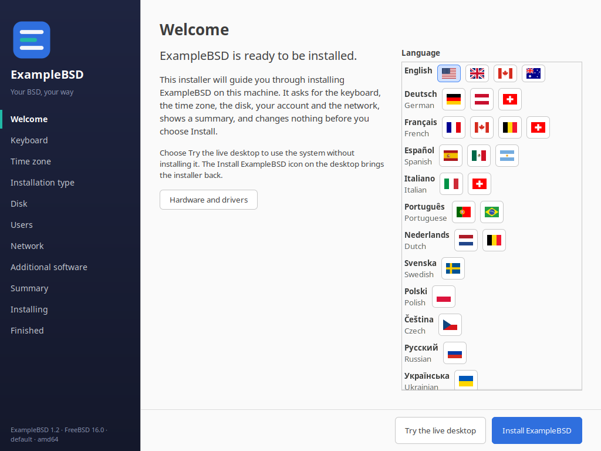 | 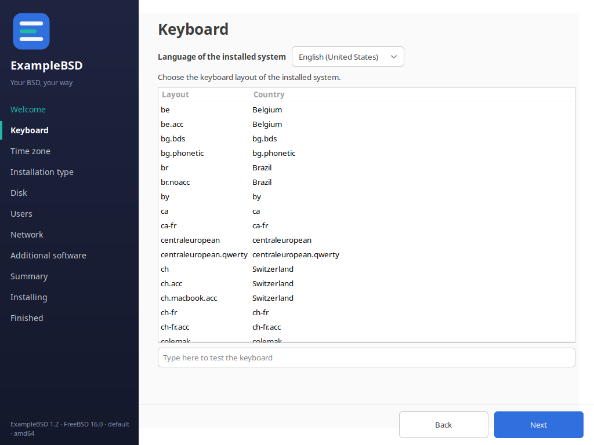 |
| 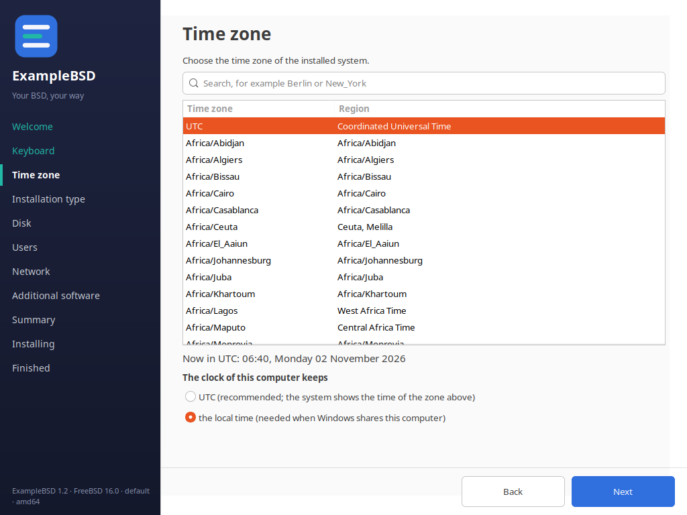 | 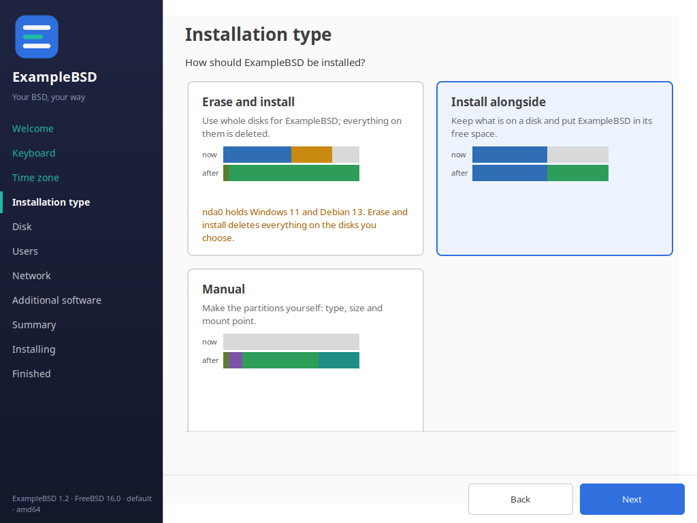 |
| 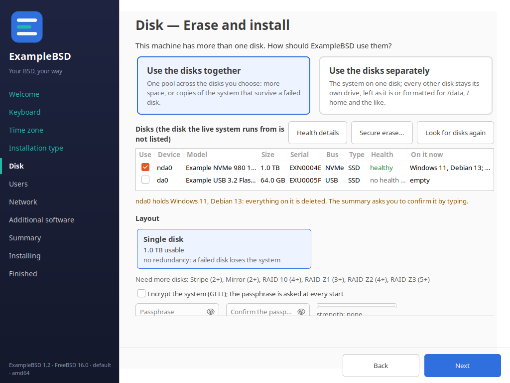 | 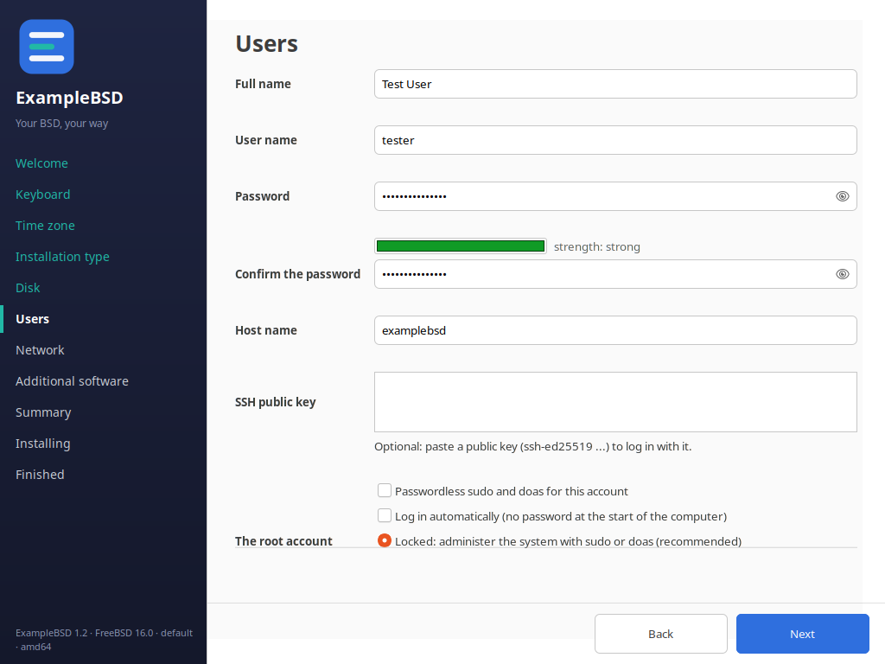 |
| 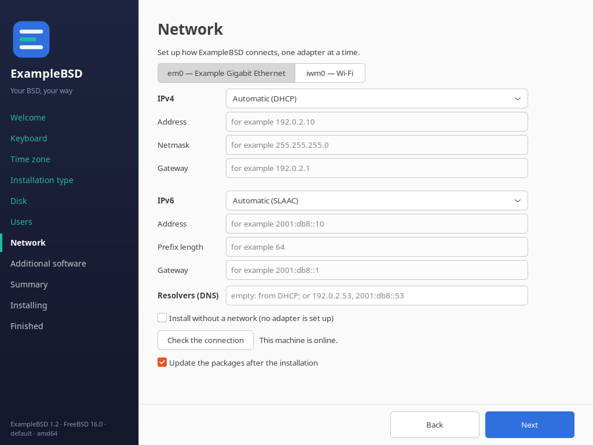 | 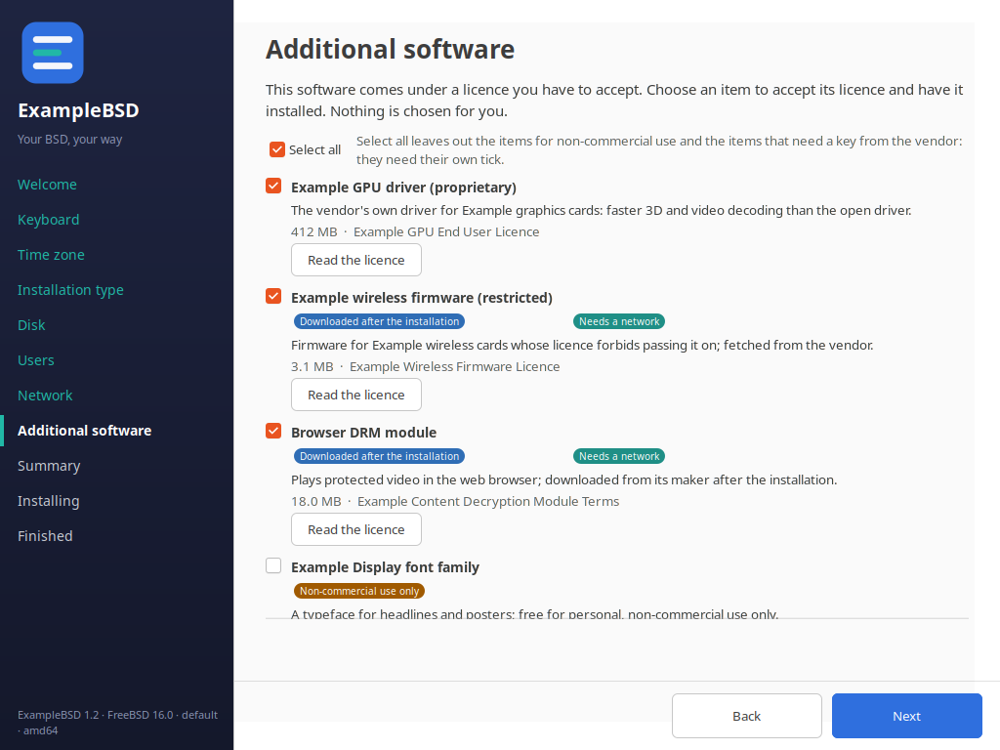 |
| 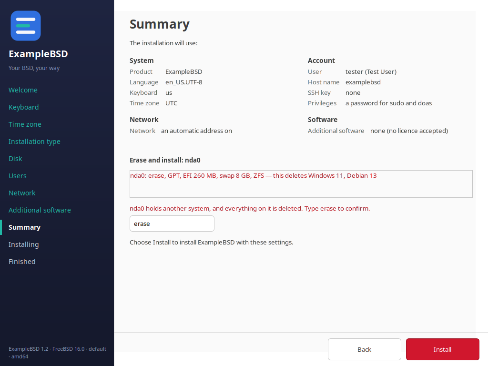 | 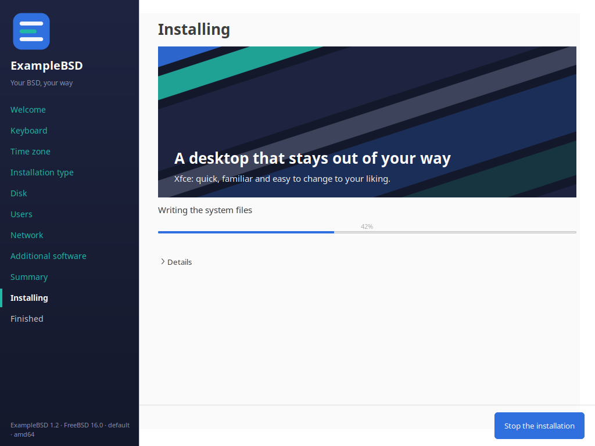 |
| 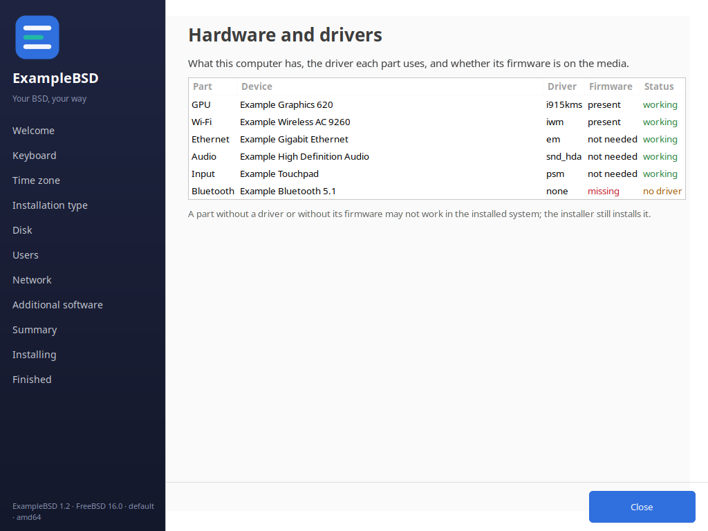 | 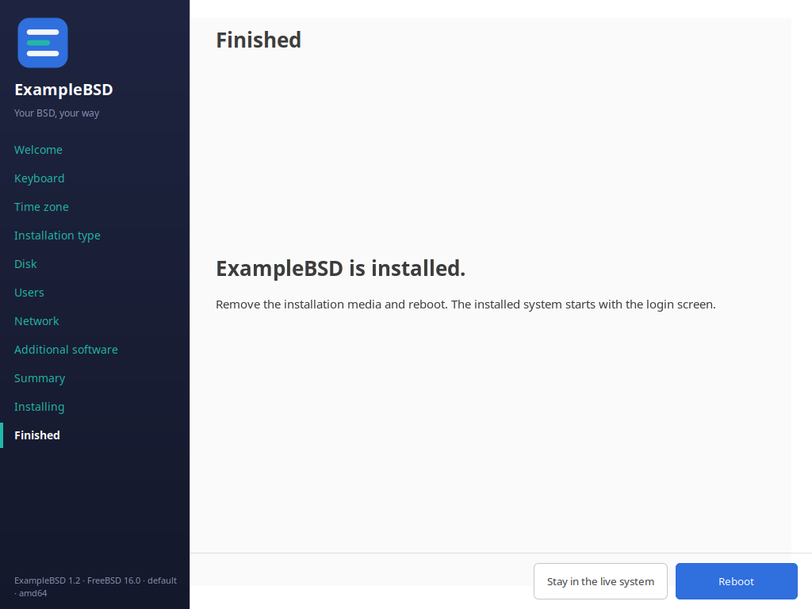 |
| 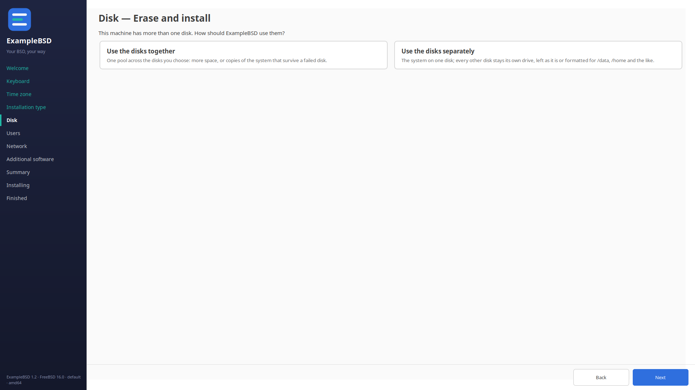 | |

Before the first page the checks of the text front end run.  A machine
without a disk, or without a network adapter, gets the "Unfortunately"
screen, which lists the requirement, what was detected and what is needed,
and offers Rescan, Override (only when it can help: no network, but a disk)
and Quit.  Override without a network installs the system offline.

The password is turned into a crypt hash when the Users page is left, in
the scheme the adapter names (`sha512`, `bcrypt` or `bcrypt-2a`), by the
crypt(3) of the system through `lib/passhash.py`.  Only the hash is written,
to a file of mode 0600 in a directory of mode 0700 in the private state of
the run, and the file is removed after every installation run.  A retry
hashes the password of the Users page again.

A failed installation stays on the Installing page with the `ERROR` line of
the install command and the place of the log, and offers Retry and "Back to
the summary".  Stop ends the whole process group of the installation after a
question whose default is to continue.

## The rules

- One action cluster, at the bottom right of every page.  The primary action
  is the rightmost button and the default (Enter); no other button is ever
  the default.
- A question has two buttons and its default is always the safe one:
  Continue for "Quit the installer?" and for "Stop the installation?".
- Escape and closing the window ask "Quit the installer?".
- The Disk and the Network page always show.  Without a disk or an adapter
  they say so and offer to look again instead of disappearing.
- A field that only matters under another option is greyed out while that
  option is off and keeps what was typed (the manual address under Manual
  address); the gating decides what reaches the answers.
- A failed check lists the requirement, what was detected and what is
  needed.
- The installer offers no way to copy text to the pasteboard.
- Every text field of the Users and the Network page is linked to its
  label: the underlined letter (Alt and the letter) moves the focus to the
  field, and a screen reader names the field when it has the focus (the
  labelled-by relation).  `tests/cases/71-gui.sh` checks every field.

## The product

The name comes from `PRODUCT_NAME` of `installer.conf`.  `PRODUCT_LOGO`, an
optional absolute path of an image, is shown above the name in the sidebar
and is the icon of the menu entry.

The look comes from the artwork template of the product:
`install-into-stage.sh --artwork DIR` puts its `palette.env`, the SVG
sources of `src/` (logo, wallpapers) and `slides/slides.txt` next to the
installer.  The palette is parsed, never sourced; the colours style the
sidebar, the buttons and the progress bar, the logo and the tagline go
above the steps, the wallpapers are the backgrounds of the slides.  The
tokens of the SVG are filled in memory, so the live system needs no
renderer.  `slides/slides.txt` holds one slide a line, `title|text|image`
(image: `wallpaper-1` to `wallpaper-3`, or empty); without it the installer
shows its own slides, in the language picked.  Without artwork, or with a
palette it cannot use (it says why), the installer keeps its built-in look.

## The identity line

The lower left of the sidebar names what is running, small and
understated: `<Product> <version> · <base BSD and version> · <variant> ·
<arch>`, and the build date on a test build.  It comes from
`/usr/local/share/<slug>/identity` (KEY=value: PRODUCT, VERSION, BASE,
VARIANT, ARCH, BUILD), written by the build of the image and parsed, never
sourced.  Without the file the line still names the product, the BSD
(uname) and the architecture.  The variant also picks the palette of the
artwork (`variants/<name>/palette.env` of the artwork template, and its own
art in `variants/<name>/src` when it has some).  The colour of the line and
of the tagline is the palette's muted colour when it reads at 4.5:1 or more
on the sidebar, else its light colour or white.

## Languages

The flags of the language picker are images shipped with the installer
(`gui/flags/<cc>.png` and `<cc>-2x.png`, rendered by `tools/render-flags.sh`
from flag-icons, MIT: see `THIRD-PARTY`), only the regions of the language
table; never characters a colour emoji font has to draw, which a live image
may not have.  A region without an image shows its two letters in a badge.

The languages of the Welcome page come from the locales of the system.
English, German and French translate every string of `lib/i18n.py`: the
page titles, the buttons, the Welcome page, the slides and the Hardware and
drivers window.  The rest of the text of the pages is English for now, and
any other language falls back to English string by string.  A test fails when a
shipped language misses a string English has.

## Running it

```
installer-gui [--windowed] [--check] [--smoke FILE [--screenshots DIR]]
```

The live image starts it through the launcher `wtfbsd-installer` (see "The
live image" in `README.md`).  Exit code 10 means "Try the live desktop"; the
session helper then leaves the user on the desktop.  When GTK cannot start,
the text front end runs in `xterm` or `xfce4-terminal`.
